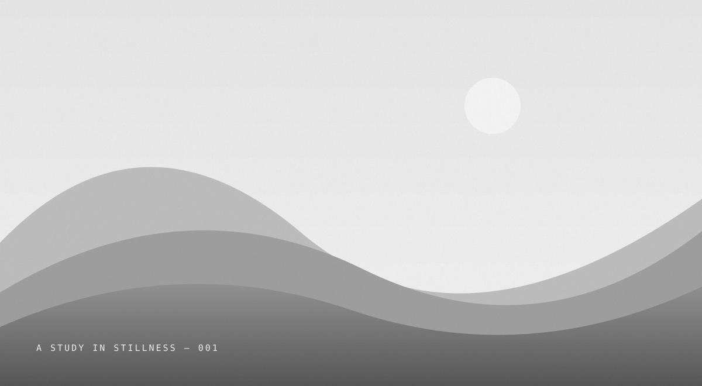

## Before leaving

One afternoon I went outside without a step count or an open map. I wanted to see what familiar streets looked like when they were no longer part of a task.

For the first ten minutes I kept inventing a purpose: get coffee, find a bookshop, walk toward the river. Then I realized that this need to do something was precisely what kept me from noticing the street itself.

## Notice what usually disappears

Plants cast small shadows on an old wall, moving like silent pendulums. A mechanic sorted screws into little boxes. Outside a convenience store, a cat tried three different positions in the sun.

_Sample illustration: a few simple contours to remember the quiet of a walk._

There was no remarkable story in any of it. These things were always there. I finally had a little time to see them.

## Not recording can be a kind of record

I did not take many photographs. Looking closely often creates an urge to save what is in front of us. Sometimes, though, saving replaces seeing.

Instead I tried to remember a color, a sound, and the temperature of the breeze. Not much remained by the time I got home, but it felt more like something I had experienced than something I had collected.

## On the way back

The walk did not produce an answer or a sudden flash of inspiration. It simply made a tense afternoon feel a little wider.

The next time you are unsure what to do, perhaps go outside for a while. You do not have to go far, and you do not have to bring anything back.
