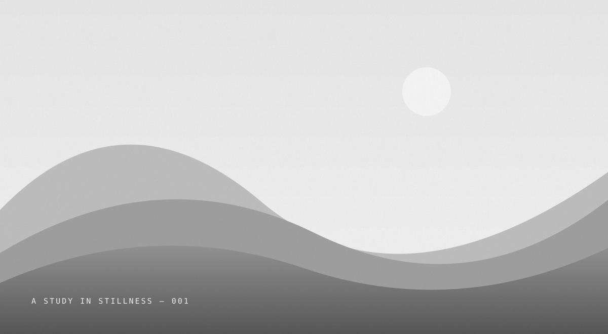

## 出门之前

那天下午，我决定出门走一会儿，没有设定步数，也没有打开地图。只是想看看，每天路过的街道在没有任务的时候，会是什么样子。

最初十分钟，我依然忍不住想给散步找一个目的：买一杯咖啡，去一家书店，或者绕到河边。后来我发现，正是这种“总要去做点什么”的念头，让我很少真正注意脚下的路。

## 看见平常看不见的东西

路边一面旧墙上有几片植物的影子，风吹过时，它们像没有声音的钟摆。一个修车的人正在整理螺丝，把不同大小的零件分进小盒子里。便利店门口，一只猫换了三个姿势晒太阳。

_示例配图：用几层简单的轮廓，记住一次散步的安静。_

这些事情没有特别的故事。它们只是一直存在，而我终于有一点时间看见。

## 不记录也是一种记录

我没有拍很多照片。停下来观察的时候，常常会有一个冲动：拿出手机，把眼前的东西保存下来。但有时保存的动作会替代观看。

于是我试着只记住一种颜色、一段声音和一阵风的温度。回家以后，能想起来的并不多，却比照片更像自己的经历。

## 回来的路

那次散步没有给我一个答案，也没有突然带来灵感。它只是让一个原本紧绷的下午，变得稍微宽阔了一点。

下一次不知道做什么的时候，也许可以先出去走走。不必走远，也不必带回什么。
